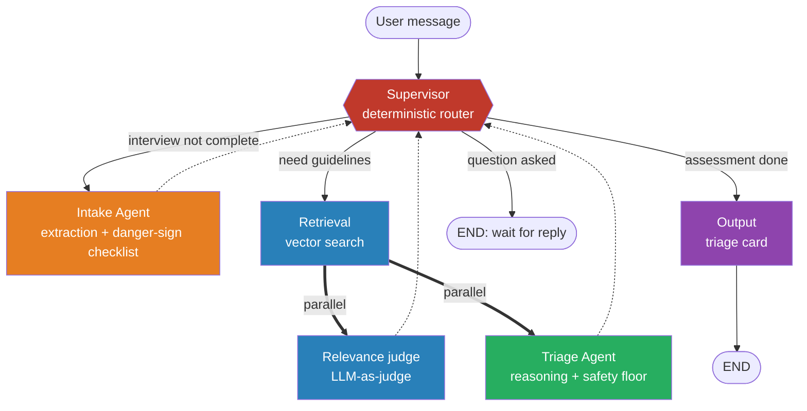

# TriageAI — Multi-Agent Clinical Triage System

A multi-agent triage assistant for community health workers, built on
**LangGraph**. It interviews the health worker or caregiver about a patient,
checks a fixed list of IMNCI danger signs, retrieves the relevant clinical
guideline text, and produces a structured triage card at one of four levels:
**Emergency**, **Urgent**, **Standard** or **Self-care**.

> **Disclaimer:** an educational prototype, not a medical device. It must not
> be used for real clinical decisions. The evaluation suite is self-written
> (see below), not a clinical validation.

---

## Architecture

A hub-and-spoke LangGraph graph. The deterministic supervisor (pure Python,
no LLM) decides every route. **Each user message is one graph run** on the
session's checkpointed state; the run ends when intake asks a question.



**Self-correction loops**
- **Retrieval:** the relevance judge and the triage agent run **in
  parallel**. If the judge rejects the guidelines, the supervisor discards
  that triage result and retrieves again with reformulated queries (at most
  3 attempts). It stops early when a retry finds no new chunk.
- **Low confidence:** if triage confidence is below 0.75, the supervisor
  sends the case back to intake. Intake asks triage's follow-up questions,
  then retrieval and triage re-run (at most 3 cycles).

**Safety layer** (`safety.py`, deterministic)
- Intake must ask every applicable danger-sign checklist group before it can
  finish: IMNCI general danger signs; breathing (breath count, chest
  indrawing, stridor); dehydration; stiff neck; adult danger signs.
- The final level is max(LLM level, rule floor). Danger signs force
  **Emergency**; fast breathing for age or some dehydration force at least
  **Urgent**. The rules never downgrade.

**State:** a LangGraph checkpointer keyed by `thread_id`. Postgres
(`CHECKPOINT_DB_URL`) in production, so sessions survive restarts; in-memory
otherwise. The browser keeps the session id (`gr.BrowserState`).

---

## Example session (real output)

From the final evaluation run (`triage-agent/eval/results/suite31_final.json`,
case A). The caregiver's replies come from the eval's **simulated caregiver**,
which answers from a hidden case description. System time per turn:
10.9 s, 7.6 s, 20.9 s.

```
👤 My 3 year old has had a cough for 4 days and seems to be breathing fast.

🤖 I need to check for danger signs. Is the child able to drink or breastfeed? Does the
   child vomit everything? Has the child had any fits (convulsions) in this illness? Is
   the child unusually sleepy or hard to wake?

👤 He is still drinking and is not vomiting everything. He has not had any convulsions,
   and he is alert.

🤖 Please count the child's breaths for one full minute while the child is calm: how many
   breaths? Does the lower chest pull in when the child breathes in? Is there a harsh
   noise when the child breathes in while calm?

👤 I counted 50 breaths in one minute, and his lower chest does pull in when he breathes
   in. There is no harsh noise when he breathes.

TRIAGE LEVEL: 🔴 EMERGENCY — Refer to hospital IMMEDIATELY.
SUSPECTED CONDITIONS:  Severe Pneumonia (95%) · Very Severe Disease (80%)
RECOMMENDED ACTIONS:   1. Give first dose of an appropriate antibiotic per IMNCI protocol
                       2. Refer URGENTLY to the nearest hospital immediately
                       3. Keep the child warm and ensure the airway is clear during transport
                       4. Do not delay referral
BASED ON:              FAST BREATHING THRESHOLDS · ASSESS AND CLASSIFY COUGH OR DIFFICULT
                       BREATHING · CHEST INDRAWING DEFINITION
Assessment confidence: High (95%)
```

The original code classified this same case **Standard**: it never asked
about chest indrawing.

---

## Evaluation

`triage-agent/eval/` has 31 **self-written** vignettes whose expected levels
are derived from the guideline text in this repo. It's a regression and
safety suite, **not a clinical benchmark** (see `triage-agent/eval/README.md`).
Headline numbers, before the hardening work and after it (full history in
[`PHASES.md`](PHASES.md)):

| 31 cases, Gemini (`gemini-3.1-pro-preview` triage, `gemini-3.8-flash` other agents) | Before (Phase 1 code) | Phase 7 (8 curated chunks) | Round 2 (874 WHO chunks) |
|---|---|---|---|
| Under-triage (the safety metric) | 10/31 | **0/31** | **0/31** |
| Accuracy (exact level) | 18/31 | 29/31 | **30/31** |
| Latency per triage, median / p95 (all turns, simulated caregiver excluded) | 63.65 s / 81.79 s | 39.92 s / 49.08 s | 43.74 s / 71.24 s |

The default Claude configuration has not been evaluated.

**Live demo:** https://triage-ai-827630707333.us-central1.run.app (Cloud Run,
scales to zero, so the first request after idle takes about 50 s; rate
limited). Three cases run through it gave the expected EMERGENCY, URGENT and
SELF CARE (`PHASES.md`, R2 Phase 5).

---

## Repo structure

```
triage-agent/
  agents/        supervisor · intake · retrieval (+ relevance judge) · triage · adk_retrieval (optional)
  safety.py      danger-sign checklist, red flags, rule-based triage floor
  graph.py       StateGraph wiring, parallel fan-out, run_turn()
  checkpointing.py  PostgresSaver / in-memory, state-type allowlist
  tracing.py     per-turn traces with per-agent spans → POST /api/v1/traces
  pricing.py     model prices (unknown price → unknown cost, never $0)
  llm.py         providers: anthropic (default), openai(-compatible), groq, together, ollama, vertexai
  rag/           fetch_guidelines · pdf_extract (table-aware) · build_kb · embeddings · Chroma store
  rag/guidelines/sources.json   WHO documents: URLs, sha256, licences, page roles
  prompts/       per-agent prompts
  app.py         Gradio UI
  eval/          cases.json (31), run_eval.py, compare.py, profile.py, results/
  deploy/        deploy_cloud_run.sh, CLOUD_RUN.md
  Dockerfile
  tests/         pytest suite
PHASES.md        per-phase changes and measurements
RESUME_FACTS.md  verified facts only
```

## Run

```bash
cd triage-agent
pip install -r requirements-dev.txt
python -m rag.fetch_guidelines         # download the WHO PDFs (sha256-checked)
python -m rag.build_kb                 # extract, chunk, embed -> ChromaDB
# or: python -m rag.ingest --sample    # only the 8 hand-written excerpts
python app.py                          # Gradio UI on :7860
pytest                                 # test suite
```

Configuration (environment):
- `LLM_PROVIDER` plus that provider's key; `MODEL_NAME` / `FAST_MODEL_NAME` optional
- `CHECKPOINT_DB_URL` (Postgres) and `BROWSER_STATE_SECRET` for persistent sessions
- `TRACE_API_URL` and `TRACE_API_KEY` for tracing
- `TEST_POSTGRES_URL` enables the Postgres tests

To run on Gemini through Google's OpenAI-compatible endpoint (how the eval was run):
```bash
export LLM_PROVIDER=openai OPENAI_API_KEY=<gemini key> \
  OPENAI_BASE_URL=https://generativelanguage.googleapis.com/v1beta/openai/ \
  MODEL_NAME=gemini-3.1-pro-preview FAST_MODEL_NAME=gemini-3.8-flash
```

Container and Cloud Run (`deploy/deploy_cloud_run.sh`: Gemini API key or Vertex AI, Neon/Postgres sessions, max 2 instances, rate limits): see
[`triage-agent/deploy/CLOUD_RUN.md`](triage-agent/deploy/CLOUD_RUN.md).

## Guideline sources and licences

The knowledge base is built from these World Health Organization publications,
downloaded from WHO IRIS when the container image is built (exact file URLs,
sha256 hashes and page roles are in
[`triage-agent/rag/guidelines/sources.json`](triage-agent/rag/guidelines/sources.json)):

| Document | Source | Licence |
|---|---|---|
| *Integrated Management of Childhood Illness: chart booklet.* WHO, 2014 (ISBN 9789241506823) | [iris.who.int/handle/10665/104772](https://iris.who.int/handle/10665/104772) | © WHO 2014, all rights reserved |
| *Handbook: IMCI integrated management of childhood illness.* WHO, 2005 (ISBN 9241546441) | [iris.who.int/handle/10665/42939](https://iris.who.int/handle/10665/42939) | © WHO 2005, all rights reserved |
| *WHO package of essential noncommunicable (PEN) disease interventions for primary health care.* WHO, 2020 (ISBN 9789240009226) | [iris.who.int/handle/10665/334186](https://iris.who.int/handle/10665/334186) | [CC BY-NC-SA 3.0 IGO](https://creativecommons.org/licenses/by-nc-sa/3.0/igo) |

The two IMCI documents carry no open licence, so this repository does **not**
contain the PDFs or text extracted from them; it only links to WHO and
downloads them at build time. WHO PEN may be reused non-commercially with
attribution, and adaptations must keep the same licence. This project is not
affiliated with or endorsed by WHO. "IMNCI" in the code is India's adaptation
of WHO IMCI; the documents used here are the WHO IMCI originals.

## Tech

LangGraph · LangChain · Pydantic · ChromaDB + sentence-transformers
(all-MiniLM-L6-v2) · Gradio 5 · PostgreSQL (langgraph-checkpoint-postgres) ·
Gemini (OpenAI-compatible endpoint / Vertex AI) · Docker / Cloud Run ·
optional Google ADK · pytest.
